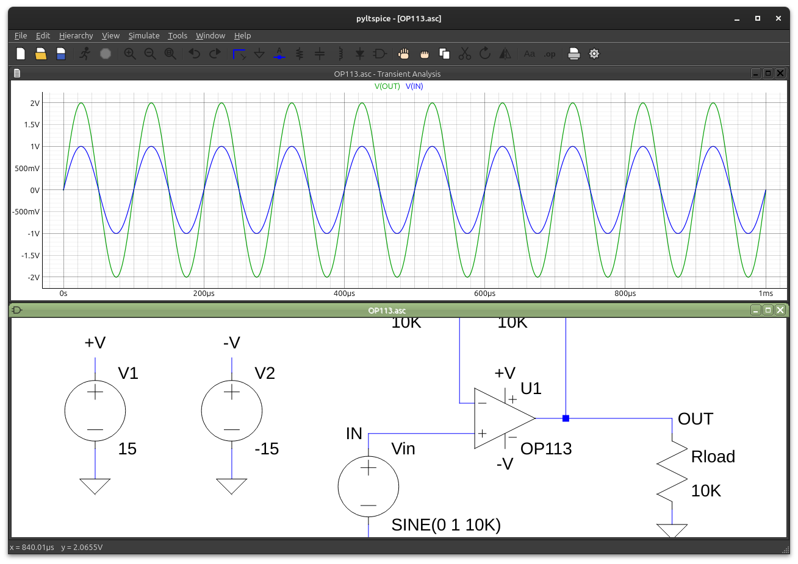

# TuxSpice

TuxSpice is a native Linux schematic capture and waveform viewer that works with LTspice files.
It opens and saves LTspice `.asc` schematics and `.asy` symbols, uses the symbol and model libraries
from your own LTspice installer, and runs simulations with [ngspice](https://ngspice.sourceforge.io/).
It does not need Wine.

It is written in Python with PySide6 (Qt), pyqtgraph and numpy.



> The Python package and command are still called `pyltspice`, so the commands below use that name.

## Features

- **Schematics**: renders LTspice schematics with symbols, rotated and mirrored text, junction dots,
  net labels, ground and I/O ports. All 4,365 bundled example schematics round-trip byte for byte,
  so files saved here still open in LTspice.
- **Looks and feels like LTspice 26** (checked side by side against LTspice running under Wine):
  its default colors and fonts, toolbar order and redrawn icons, window tabs, mode cursors,
  status-bar hints and dialog layouts. The menu bar swaps between LTspice's three layouts (no
  window, schematic, waveform), item for item with LTspice's icons and keys, and the right-click
  menus of schematics and plots match too. Keys mean what they mean in LTspice for the active
  window (C places a capacitor on a schematic, a cursor on a plot).
- **Settings** (Tools > Settings): LTspice's ten tabs. Drafting options, schematic font and pen
  thickness, waveform font and trace width, toolbar icon size, background image, save-on-run,
  .raw/.log directory, automatic .raw deletion, SPICE tolerances and integration method (passed
  to ngspice as `.options`), netlist µ→u and order, and symbol/library search paths all work.
  As in LTspice, only settings marked [*] are remembered. Options that have no ngspice
  equivalent (solver, threads, compression, hacks) are shown greyed out with a tooltip.
- **Editing**: LTspice-style editing modes (place, wire, label, move, stretch, duplicate, rotate,
  mirror, delete, zoom area, search), undo/redo, LTspice's own placement and wiring behavior
  (parts carried by their middle, labels kept upright on rotation, click an open pin to start a
  wire), the component browser, R/C/L editors with "Select Resistor/Capacitor/Inductor" from
  LTspice's part databases, source, net-label, text and analysis dialogs, the attribute editor,
  and LTspice 26's default shortcuts (W/G/V/R/C/L/D/P/N/T, `.` directive, S stretch, Z zoom
  area, Alt+R run; XVII's F2–F9 still work).
- **Simulation**: netlists the schematic and translates the LTspice dialect for ngspice:
  - parasitics (`Rser`, `Cpar`, ...), one-argument `.tran`, `.lib`, default models, `table()`,
    LTspice functions (`u()`, `uramp()`, `rand()`, `random()`, `white()`, `mc()`, ...),
    frequency lists in `.ac`/`.noise`, hierarchical sheets
  - Laplace sources: rational functions, delays `exp(-sT)` and `sqrt()` terms (approximated to ~0.1 dB)
  - `wavefile=` sources, hysteretic-core (`Hc`/`Bs`/`Br`) and `Flux=` inductors
  - every LTspice `A` device: OTA, logic gates, flip-flops, Schmitt triggers (incl. differential),
    sample-and-hold, modulator/VCO, varistor, phase detector and counter
  - model-library quirks: per-subcircuit model scoping, LTspice ideal diodes and switch
    extensions, VDMOS defaults, perfect (k = 1) coupling, threshold `G` clamps (`vto=`/`dir=`),
    `load` current sources, behavioral `R=`/`Q=` elements, device currents such as `Id(M3)` in
    expressions, `temp` and `smallsig()` in expressions, nested `{}` braces, symbols that skip
    pin numbers
  - ngspice-only analyses LTspice lacks: `.pz` (pole-zero table) and `.disto` (2nd/3rd harmonic
    distortion plots)
  - IGBTs are approximated by a MOSFET-plus-transistor equivalent circuit (with a warning).

  `.step` (linear, octave, decade, list) and `.meas` are handled by TuxSpice itself. Measurements
  can use earlier results, and are reported per step in the SPICE Error Log (Ctrl+L).
- **Waveforms**: stacked plot panes (add above/below, move, delete), colored trace labels, dB and
  phase for AC, a second axis for currents, trace arithmetic with `plot.defs` user functions,
  average/RMS, cursors, FFT, step selection, manual limits, data-point marks, undo/redo of trace
  changes, notes and annotations (text, arrows, lines, boxes, ellipses, cursor position),
  Execute .MEAS Script, and `.plt` plot settings (save, open, reload).
- **AI assistants (MCP)**: like LTspice 26.1, TuxSpice has a local MCP server, so assistants such as
  Claude Code, Claude Desktop, Cursor or GitHub Copilot can read, edit and simulate your designs and
  read the results. It offers the same tools as LTspice's server. See [AI assistants](#ai-assistants-mcp).
- **Output**: print, print preview and setup (optionally monochrome), SVG/PNG images, subcircuit
  netlists of a sheet, and PCB netlists (Tango, PADS, Allegro/Telesis, wire list).
- **Probing**: click a wire to plot its voltage, a part to plot its current, Alt-click a part to plot its power.

### How many LTspice examples run

| Example set | Result |
|---|---|
| Educational (82 top level, 100 with subfolders) | **79/82**: Royer needs an encrypted model, Electrometer runs but takes ~5 minutes, PLL2 stalls in ngspice. With subfolders: 10 need encrypted models and 87 of the other 90 run (the third is a Frequency Response Analysis example) |
| Applications (4,277) | 3,322 need an encrypted ADI model (see Limitations). Of the other 1,043, **929 (89%)** simulate; 102 fail and 12 time out at 60 s |

[`pyltspice/docs/PLAN.md`](pyltspice/docs/PLAN.md) lists what still fails and why.

## How TuxSpice compares

| | TuxSpice | LTspice | ngspice | KiCad |
|---|---|---|---|---|
| Runs natively on Linux | yes | no (Windows/macOS; Wine on Linux) | yes | yes |
| Schematic editor | yes, LTspice-style | yes | no (text netlists only) | yes, KiCad-style |
| Opens/saves LTspice `.asc`/`.asy` unchanged | yes, byte for byte | yes | no | imports `.asc` into its own format (KiCad 8+), doesn't save `.asc` |
| Uses LTspice's symbol/model libraries | yes (from your installer) | yes | by hand, many models need edits | by hand |
| LTspice dialect (A-devices, Rser/Cpar, `table()`, Laplace, `.step`, `.meas`...) | translated for ngspice | native | partly (`ngbehavior=lt`) | via ngspice, partly |
| Encrypted ADI models | no | yes | no | no |
| Simulation engine | ngspice | LTspice's own | itself | ngspice |
| Waveform viewer | LTspice-style, `.raw` files | yes | basic plots | yes |
| PCB layout | no | no | no | yes |

- **Compared with ngspice**: ngspice is only the simulator (a command-line program that reads
  netlists), and TuxSpice uses it underneath. On top of it, TuxSpice provides the schematic
  editor and waveform viewer, and a translation layer that makes LTspice schematics and vendor
  model libraries run unmodified. That layer handles LTspice-only devices and syntax, ADI
  macro-model quirks, `.step`/`.meas` (done by TuxSpice), and smoothing and retries where
  ngspice converges differently. You also get ngspice's own extras, such as `.pz` and `.disto`.
- **Compared with KiCad**: KiCad is a full schematic-to-PCB suite whose simulator also uses
  ngspice. It has its own schematic format, symbol libraries and SPICE model assignment, and it
  can import LTspice schematics, but it doesn't edit them as LTspice files and doesn't use
  LTspice's libraries and dialect directly. TuxSpice does one thing: it is a drop-in LTspice
  work-alike for Linux. Your `.asc` files stay LTspice files, and the libraries, shortcuts and
  workflow are LTspice's. It has no PCB layout.
- **Compared with LTspice**: same files, same libraries, same editing model, but a different
  simulator. Results usually match closely but not exactly, encrypted ADI models can't run,
  and some circuits are slower in ngspice.

## Requirements

- Linux, Python 3.10 or newer
- ngspice (`sudo apt install ngspice`)
- 7z, to extract the libraries (`sudo apt install p7zip-full`)
- Your own copy of the LTspice installer, `LTspice64.msi`, which you can download from Analog Devices

## Installation

```sh
python3 -m venv .venv
.venv/bin/pip install -e pyltspice

# Optional: TuxSpice offers this itself on first start (it looks for LTspice64.msi in
# Downloads, Desktop and your home folder). From the command line:
.venv/bin/python pyltspice/scripts/extract_msi.py LTspice64.msi
```

The libraries are extracted to `~/.local/share/pyltspice/ltspice_lib`. They stay on your machine;
TuxSpice does not include or redistribute any LTspice files.

To add a desktop launcher, an icon, and `.asc`/`.raw` file associations (writes only under
`~/.local/share`):

```sh
.venv/bin/python pyltspice/scripts/install_desktop.py           # install
.venv/bin/python pyltspice/scripts/install_desktop.py --remove  # uninstall
```

## Usage

```sh
pyltspice                     # new schematic
pyltspice circuit.asc         # open a schematic
pyltspice results.raw         # open a waveform file
python -m pyltspice ...       # same as above
```

### AI assistants (MCP)

TuxSpice includes a local [MCP](https://modelcontextprotocol.io) server, `pyltspice-mcp`, that AI
assistants launch over stdio. It is compatible with LTspice 26.1's `ltspice-mcp-bridge`: same tools,
arguments, annotations, reply format, error messages and SQLite export schema, checked call by call
against the real bridge (`scripts/mcp_diff.py`). Prompts and scripts written for LTspice work here:

- open designs, read and replace their text, generate the netlist
- run simulations, poll them and read the SPICE log (including `.meas` results)
- list signals in the results, read waveform data (windowed, per `.step`, dB/phase for AC), or
  export it to SQLite
- read reference documentation: LTspice's AI reference from your installer (extracted by
  `scripts/extract_msi.py`) plus notes on how TuxSpice differs

If TuxSpice is running, the assistant shares that window: it sees your open documents, its edits
appear live and each one is a normal undo step (Ctrl+Z), and nothing is saved until you save.
Otherwise the server works headless on files (edits are written to disk). Running windows listen
on 127.0.0.1 only, with a per-session token in a file only you can read.

To set it up, use **Tools > Configure Third-Party AI Assistants...**. It detects and configures
Claude Code, Claude Desktop, Cursor and VS Code (GitHub Copilot), for your user or for one project
folder. TuxSpice also offers this once at startup. Or register it by hand as a stdio server named
`tuxspice`, for example:

```sh
claude mcp add --scope user tuxspice -- /path/to/.venv/bin/python -m pyltspice.mcp
```

Assistants send what they read to their provider's servers, so don't connect one to designs you
can't share with that provider, and check what it changes. Set `PYLTSPICE_NO_MCP=1` to keep a
TuxSpice window from accepting assistants.

### Configuration

| Variable | Purpose |
|---|---|
| `PYLTSPICE_DATA` | Data directory (default `~/.local/share/pyltspice`) |
| `PYLTSPICE_LIB` | Extracted library directory (default `<data>/ltspice_lib`) |
| `PYLTSPICE_NGSPICE` | Path to the ngspice binary (default: a copy in the data directory, then `/usr/bin/ngspice`) |
| `PYLTSPICE_NO_MCP` | Don't let AI assistants attach to this window (no MCP host, no startup offer) |

Colors and other preferences are stored in `~/.config/pyltspice`.

## Limitations

- Encrypted Analog Devices models (about 3,000 of the files in `lib/sub`, needed by 3,322 of the
  bundled examples) only run inside LTspice. TuxSpice reports them as unsupported and doesn't
  decrypt them.
- `COUNTER` is undocumented in LTspice and no example uses it; TuxSpice models it as a clock
  divider (`cycles=` sets the ratio). The phase detector works on its own, but ngspice can stall
  inside some PLL loops (the PLL2 example).
- Some LTspice-only commands are not available: `.machine` state machines, `.timedomain`, the
  Transient Frequency Response analysis, efficiency reports, `.wave` export.
- Some LTspice menu commands are present but greyed out because they're not implemented yet:
  the symbol editor (New Symbol), buses (BUS tap), Paste between schematics, marching waveforms,
  eye diagrams, phase/gain margin annotations and Fast Access files. Images are written as SVG
  or PNG instead of EMF.
- ngspice converges differently from LTspice, so a few circuits fail or need relaxed options.
  TuxSpice retries non-converging runs automatically, for at most 30 seconds per retry.
- Some circuits are slow in ngspice: the Electrometer example takes about 5 minutes. Use Halt
  to stop a run.

## Development

Run these from the `pyltspice/` directory:

```sh
../.venv/bin/pip install -e '.[test]'
../.venv/bin/python -m pytest -q                                # full test suite, ~6 s
../.venv/bin/python scripts/sim_example.py ../work <asc...>      # headless netlist + sim, OK/FAIL per file
../.venv/bin/python scripts/sweep_examples.py ../work/out.tsv <dir|asc...>  # parallel compatibility sweep
../.venv/bin/python scripts/render_png.py <asc> <png>            # render a schematic to PNG
QT_QPA_PLATFORM=offscreen ../.venv/bin/python scripts/gui_smoke.py ...  # drive the GUI headlessly
```

Layout (inside `pyltspice/`):

| Path | Contents |
|---|---|
| `pyltspice/model/` | `.asc`/`.asy` formats, symbol library, netlister, edit operations |
| `pyltspice/sim/` | LTspice → ngspice translation, runner, `.raw` reader, `.meas`, FFT, A-device, Laplace, magnetics and `.wav` emulation |
| `pyltspice/ui/` | Qt main window, schematic editor, dialogs, waveform viewer |
| `scripts/` | Library extraction, desktop install, headless sim and rendering tools |
| `docs/PLAN.md` | Roadmap and status |
| `docs/ui_spec.md` | Every LTspice menu, shortcut and behavior with its implementation status |

### Clean-room policy

UI parity with LTspice comes only from LTspice's documented behavior (its help pages) and from
watching it run. Contributions must not decompile or disassemble `LTspice.exe` or copy its bitmaps.
Toolbar icons are drawn in code.

## Disclaimer

TuxSpice is an independent project. It is not affiliated with, endorsed by, or supported by
Analog Devices. LTspice is a trademark of Analog Devices, Inc.
